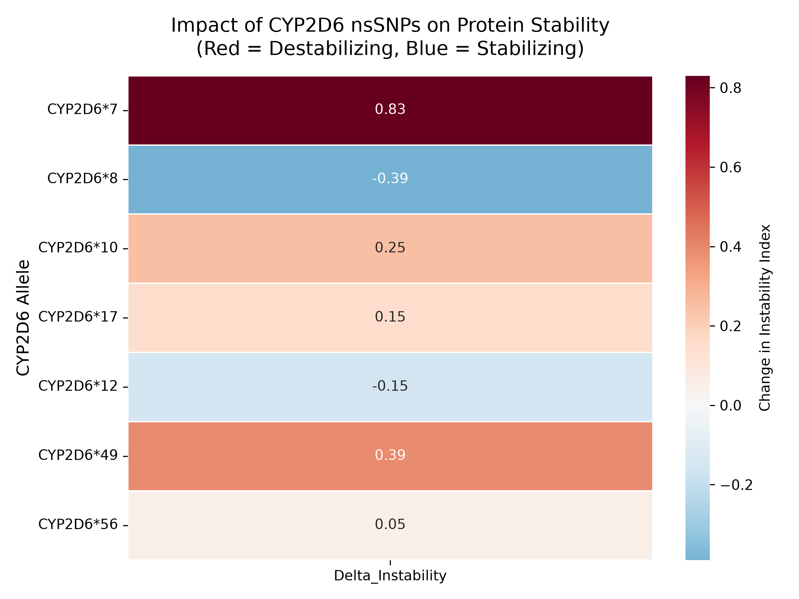

# In Silico Pharmacogenomic Analysis of Human CYP2D6 nsSNPs [](https://doi.org/10.5281/zenodo.2365700)

## 🧬 Biological Context
Cytochrome P450 2D6 (CYP2D6) is a crucial liver enzyme responsible for the metabolism of approximately 25% of clinically administered drugs. Non-synonymous single nucleotide polymorphisms (nsSNPs) in the *CYP2D6* gene can lead to altered enzyme activity, resulting in adverse drug reactions or therapeutic failure. 

This project performs an *in silico* analysis to predict the impact of 7 clinically relevant CYP2D6 mutations on the physicochemical properties and structural stability of the resulting protein.

## ⚙️ Methodology
This pipeline is built entirely in Python and utilizes the following libraries:
- **Biopython (`Bio.SeqUtils.ProtParam`)**: Used to calculate the Instability Index, GRAVY (Grand Average of Hydropathy), Molecular Weight, and Isoelectric Point for both the wild-type and mutant protein sequences.
- **Pandas**: Used to structure the calculated physicochemical deltas into a DataFrame and export them as a CSV.
- **Seaborn & Matplotlib**: Used to generate a static, publication-quality heatmap visualizing the change in protein stability.
- **Plotly**: Used to generate an interactive HTML scatter plot to explore the relationship between hydrophobicity and molecular weight changes.

## 📊 Results
The analysis calculates the **Delta Instability Index** (Mutant Instability - WT Instability). A positive value indicates that the mutation is **destabilizing** (makes the protein less stable), while a negative value indicates it is **stabilizing**.

*Key Finding:* Most analyzed mutations (e.g., H324P, P34S, F120I) are predicted to be destabilizing, which aligns with their known clinical phenotypes of reduced enzyme activity. 

### Visualizations
#### 1. Stability Heatmap


#### 2. Interactive Physicochemical Plot
Open `interactive_physicochemical_plot.html` in any web browser to view an interactive Plotly graph. Hover over the data points to see the exact changes in molecular weight and hydrophobicity for each allele.

## 🚀 How to Run This Project

1. **Clone the repository:**
   ```bash
   git clone https://github.com/YourUsername/cyp2d6-nsSNP-stability-analysis.git
   cd cyp2d6-nsSNP-stability-analysis
